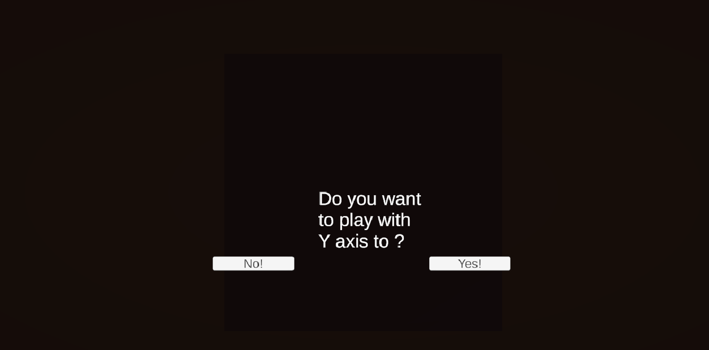
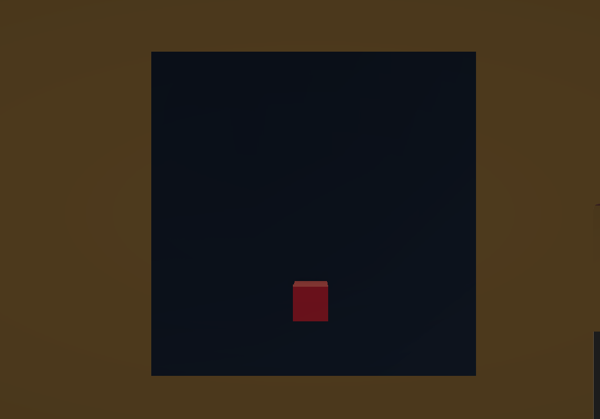
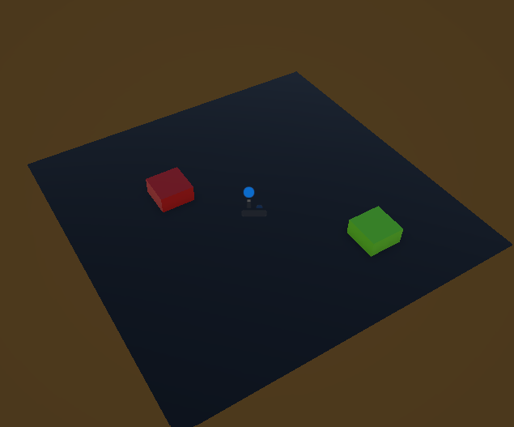
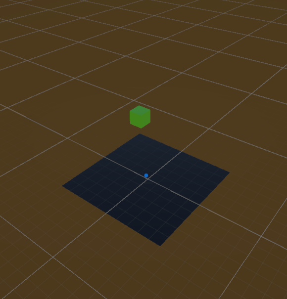
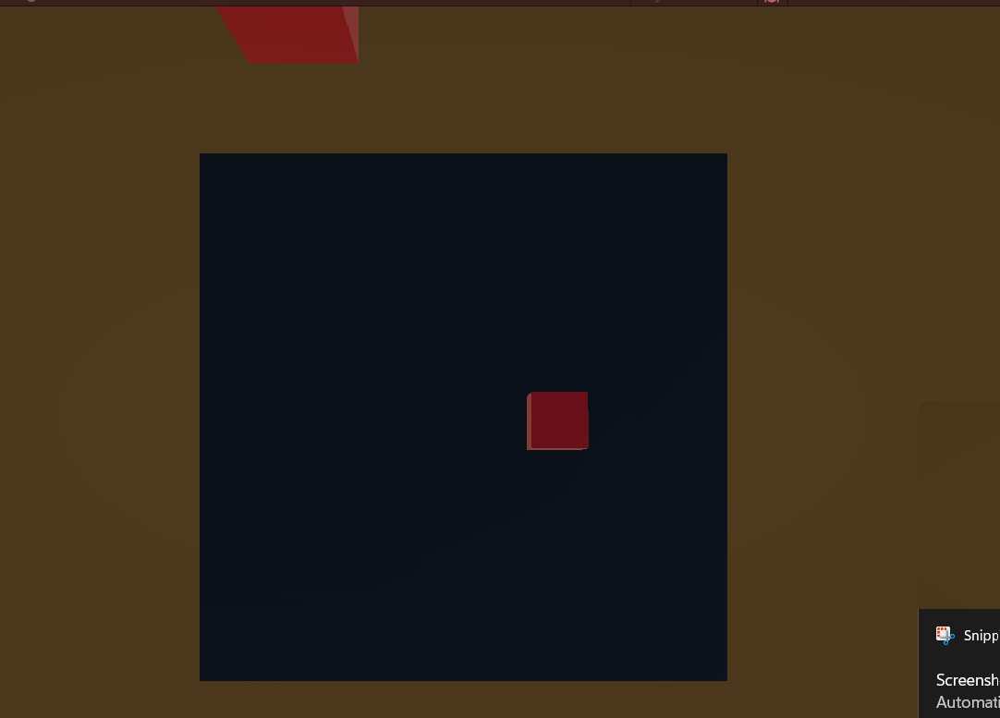
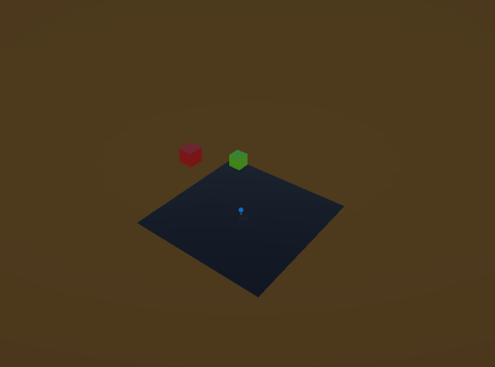

# Fruit cutting version_3 

This version is different from the first version and second because this time player can choose. either he wants to play with y-axis or on the ground so i made a bullshit system for it. 

##chancing

Random Y-axis 
Choose between ground or Y-axis to fall a object

## Example photo

## Ground´s

## Fall objects

